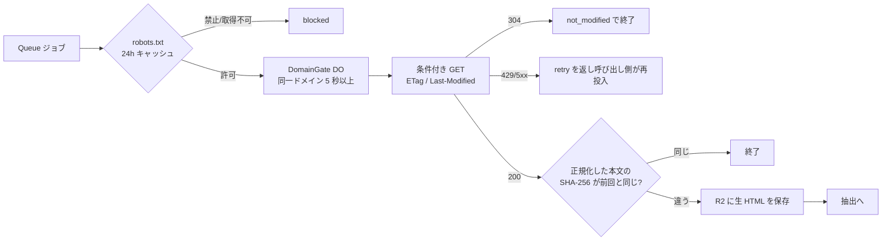
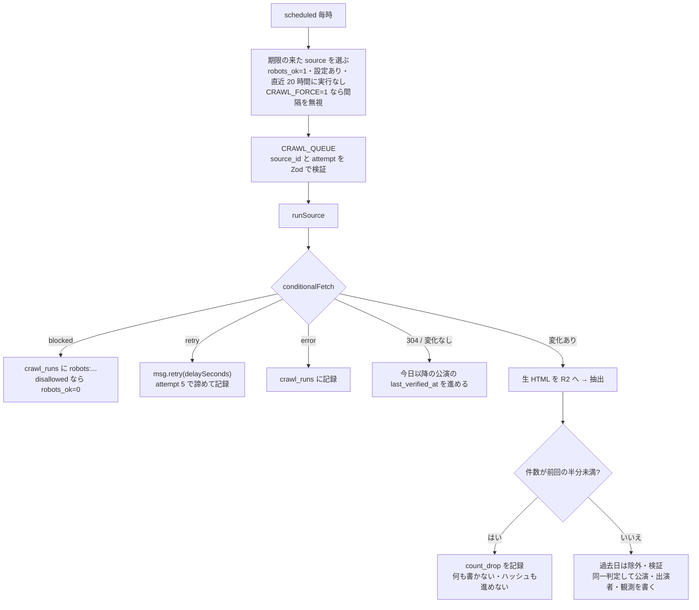

# apps/crawler

Cron・Queue コンシューマー・抽出を担う Worker。取得（`src/fetch/`）→ 変化検知・生 HTML 保存（`src/change/`）→ 抽出（`src/extract/`）→ D1 保存（`src/store/`）を `src/pipeline/` がつなぐ。

## 概要



## User-Agent と連絡先

`live-info-mcp-crawler/0.1 (+<連絡先 URL>)`。URL は環境変数 `CRAWLER_CONTACT_URL` で渡す。未設定の間は連絡先を付けず、`live-info-mcp-crawler/0.1` だけで名乗る（他人のドメインを連絡先に見せかけないため）。毎日の自動実行を始める前に、掲載停止の窓口 URL を必ず設定すること（個人情報は入れない）。

本番へのデプロイ手順は [docs/deploy.md](../../docs/deploy.md)。

## ドメインの間隔

`DomainGate`（SQLite バックエンドの Durable Object、ドメインごとに 1 インスタンス）が同一ドメインへのリクエストを 5 秒以上あける。robots.txt の `Crawl-delay` が大きければそちらに従う。`wrangler.jsonc` の `migrations` で `new_sqlite_classes` として登録済み。

## 生 HTML の 30 日削除

保存先は `raw/<sourceId>/<JST の日付>/<ハッシュ>.html`。30 日での削除は Worker のコードではなく、**R2 のライフサイクルルールをデプロイ時に設定して**行う。

```sh
wrangler r2 bucket lifecycle add live-info-raw-html raw-html-30d raw/ --expire-days 30
```

コマンドの形（位置引数 `<bucket> [name] [prefix]` と `--expire-days`）は `wrangler r2 bucket lifecycle add --help` で確認した。実際のバケットに対する適用は未実行（リモートのリソースは作っていない）なので、デプロイ時に `wrangler r2 bucket lifecycle list live-info-raw-html` で反映を確かめる。

## パイプライン（runSource）



- source id は `src_<venue_id>`。URL は設定に `url_template` があれば `now`（JST）で埋め、無ければ `sources.url`
- 検証の issue があった公演（出演者なし・時刻拒否など）は保存して `needs_review = 1`。実在しない日付だけ捨てる。過去日は黙って捨てる（`skipped_past`）
- 同一判定（`src/store/plan.ts`）は requirements 設計判断 1 の規則に、同じ id（venue・date・start・title）なら同一、を足したもの。1 回の実行で既存の 1 公演に当たれるのは 1 件まで。同じ実行で入れた同日の兄弟カードは「既存」に数えず flag しない
- `needs_review` は一度立てたら更新では下ろさない。変化なしの回は `updated_at` を動かさず `last_verified_at` だけ進める
- Queue は `max_batch_size: 1`・`max_concurrency: 1`。再試行の回数は配送回数（`msg.attempts`）で数える
- 変化なしの回の `last_verified_at` 更新は「これまでに観測した今日以降の公演」すべてが対象で、ページから消えた公演の検出は未実装（T12）

## ローカル実行（実サイトに触れない）

フィクスチャをローカルの HTTP で配り、`wrangler dev` で crawler と MCP を通す。永続化先を `--persist-to ../../.wrangler/state` に揃えると apps/mcp と同じ D1 を見る。

```sh
# 1. フィクスチャ配信（別ターミナル）
node scripts/serve-fixtures.mjs 8899

# 2. D1 の準備（apps/crawler で）
cd apps/crawler
printf 'CRAWL_FORCE=1\n' > .dev.vars   # gitignore 済み
npx wrangler d1 migrations apply live-info --local --persist-to ../../.wrangler/state
for f in venues sources source-configs dev-local-sources; do
  npx wrangler d1 execute live-info --local --persist-to ../../.wrangler/state --file ../../seeds/$f.sql
done

# 3. 起動して cron を手動で発火（5 会場ぶん、5 秒間隔のゲートがあるので 2 分ほど待つ）
npx wrangler dev --test-scheduled --port 8787 --persist-to ../../.wrangler/state
curl "http://localhost:8787/cdn-cgi/handler/scheduled"

# 4. 結果
npx wrangler d1 execute live-info --local --persist-to ../../.wrangler/state \
  --command "SELECT venue_id, COUNT(*) FROM events GROUP BY venue_id"
npx wrangler d1 execute live-info --local --persist-to ../../.wrangler/state \
  --command "SELECT source_id, http_status, changed, error FROM crawl_runs"
```

`seeds/dev-local-sources.sql` は取得先をローカル URL に向け、月別の `url_template` を `json_remove` で外す（残すと実サイトを取りに行く）。本番には流さない。同じフィクスチャでの 2 回目の実行は `changed = 0` になり、公演は増えない。MCP は `apps/mcp/README.md` の手順で `--port 8791` に起動して引く。
