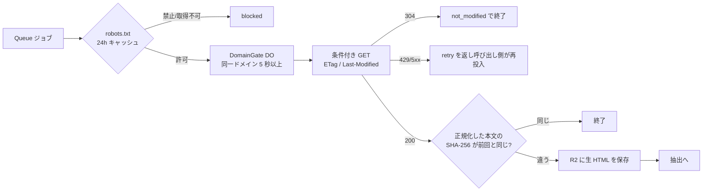

# apps/crawler

Cron・Queue コンシューマー・抽出を担う Worker。いまは取得（`src/fetch/`）と変化検知・生 HTML 保存（`src/change/`）まで。

## 概要



## User-Agent と連絡先

`live-info-mcp-crawler/0.1 (+<連絡先 URL>)`。URL は環境変数 `CRAWLER_CONTACT_URL` で渡す。未設定の間は `https://example.com/crawler` のプレースホルダーで動くので、公開前に掲載停止の窓口 URL を設定すること（個人情報は入れない）。

## ドメインの間隔

`DomainGate`（SQLite バックエンドの Durable Object、ドメインごとに 1 インスタンス）が同一ドメインへのリクエストを 5 秒以上あける。robots.txt の `Crawl-delay` が大きければそちらに従う。`wrangler.jsonc` の `migrations` で `new_sqlite_classes` として登録済み。

## 生 HTML の 30 日削除

保存先は `raw/<sourceId>/<JST の日付>/<ハッシュ>.html`。30 日での削除は Worker のコードではなく、**R2 のライフサイクルルールをデプロイ時に設定して**行う。

```sh
wrangler r2 bucket lifecycle add live-info-raw-html raw-html-30d raw/ --expire-days 30
```

コマンドの形（位置引数 `<bucket> [name] [prefix]` と `--expire-days`）は `wrangler r2 bucket lifecycle add --help` で確認した。実際のバケットに対する適用は未実行（リモートのリソースは作っていない）なので、デプロイ時に `wrangler r2 bucket lifecycle list live-info-raw-html` で反映を確かめる。
