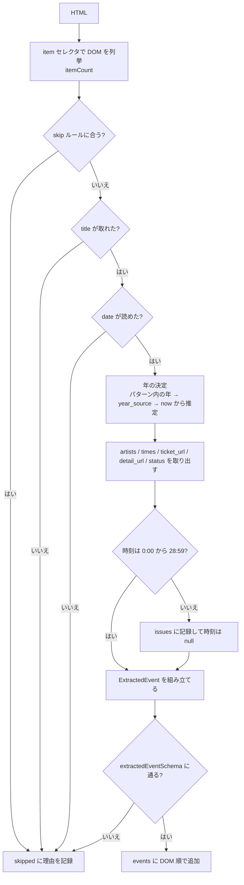

# 抽出（extract）

## 概要

HTML を会場ごとの JSON 設定（A）に従って `ExtractedEvent[]` にする、LLM を使わない抽出エンジン。設定は純データで、コードは会場ごとに増えない。設定の置き場は `apps/crawler/venue-configs/<venue_id>.json`、D1 へは `npm run seed:configs` で作る `seeds/source-configs.sql` が `sources.config_json` に入れる。

```ts
const config = venueExtractConfigSchema.parse(JSON.parse(sources.config_json))
const url = config.url_template ? fillUrlTemplate(config.url_template, now) : sources.url
const { events, itemCount, skipped, issues } = extractEvents(html, config, { now, sourceUrl: url, venueId })
```

`itemCount` は `item` セレクタに合った DOM の数。`itemCount` が 0 ならレイアウト変更の疑いなので、呼び出し側が needs_review にする。`skipped` は公演にしなかった item の理由（メンテナンス等・タイトルなし・日付が読めない）、`issues` は時刻の拒否（29:00 以上など）。

## 処理の流れ



## 設定 DSL

| キー | 役割 |
|---|---|
| `version` / `strategy` | `1` と `"dom"` 固定 |
| `comment` | 設計判断の記録。抽出には使わない |
| `url_template` | 月別 URL。`{YYYY}` `{MM}`（2 桁）`{M}`（0 埋めなし）を `now` の JST 年月で埋める |
| `item` | 1 公演の要素のセレクタ |
| `skip[]` | `{ reason, when }`。合った item は公演にしない |
| `fields.date` | `source` の値を `pattern`（名前付きグループ `month` `day` と `year` か `yy`）で読む。年が無ければ `year_source`、それも無ければ `now` から推定 |
| `fields.title` | `sources[]` を `mode`（`first`=空でない最初 / `join`=空白連結）で組む |
| `fields.artists` | `selector` に合う要素を 1 要素 1 組に。`split` があれば最初の要素の text（`<br>` は改行）を分割。`strip` で装飾を除き、`exclude` で省略記号を捨てる |
| `fields.times` | `source` の値に `patterns[]` を上から当て、最初に合ったものの `open` `start` グループを使う。範囲 `23:00-4:30` は `start` だけ拾えば終了側は無視できる |
| `fields.ticket_url` / `detail_url` / `price_text` | `source` の値。URL は http(s) の絶対 URL に直し、直せなければ null（detail_url は取得 URL に戻る） |
| `fields.status[]` | `{ value, when }` を上から評価。どれも合わなければ null |

`source`（値の取り出し元）は「基準ノード（`from`: `item` 既定 / `page` / `prev-sibling` / `url`）→ `label` → `selector` → `attr`（無ければ text）」の順に絞る。`label` は `{ selector, pattern }` に合う要素の**次の兄弟要素**を基準にする（duo の `dt` → `dd`）。`when`（条件）は `has`（要素の有無）と `text_matches`（正規表現。`in` でその要素の text）で、両方書けば AND。

正規表現はすべて `u` フラグ。時刻は 1 桁時を 2 桁に揃え（`9:00` → `09:00`）、`parseShowTime` に通す。24:00 や 28:59 は受け入れ、29:00 以上は `issues` に積んで時刻だけ null にする。

## 会場ごとの割り切り

| 会場 | 割り切り |
|---|---|
| SHELTER / LOFT | `.soldout` は「予約締切」で完売とは限らないので status に写さない。LOFT のメンテナンスは skip |
| duo | 1 日 2 部の `①13:45 / 14:30 ②18:15 / 19:00` は先頭の部だけ。`24:00` 単独は start のみ。ページに完売表記がなく status は null |
| WOMB | トップページの SSR カードのみ（約 10 件）。月単位の網羅は RSC の JSON が要るので未対応。`23:00-4:30` は start=23:00 |
| UNIT | 一覧に start がなく open のみ。出演者は区切りが公演ごとに揺れ、カンマ区切りの行は 1 件にまとまる |
| O-nest / O-Crest / O-WEST | 同じテーマで URL 以外同じ設定。年は URL の `y`。`SOLD OUT` は sold_out |
| CLUB QUATTRO | 日付は `data-event-date`。「1回目 … 2回目 …」は先頭の回だけ。出演者の `[ ]` 内のメンバー表記も `/` で分かれる |
| La.mama / THE ROOM | 一覧に時刻がなく時刻は null。La.mama の DOM 順は日付順でない |
| SPACE ODD | クラスが Tailwind だけなので日付・時刻はカード全体の text に正規表現。「Coming soon…」は skip |
| Circus Tokyo | 直近の約 24 件のみ。開始-終了の表記で start だけ。【SOLD OUT】は sold_out |
| BATICA / solfa | The Events Calendar の当月表示。カレンダーの開始時刻を open に。「TBA」は skip、終日の CLOSED は item にならない |

batch 1 の会場ごとの調査メモと見送った会場は `docs/venues-batch-1.md`。
