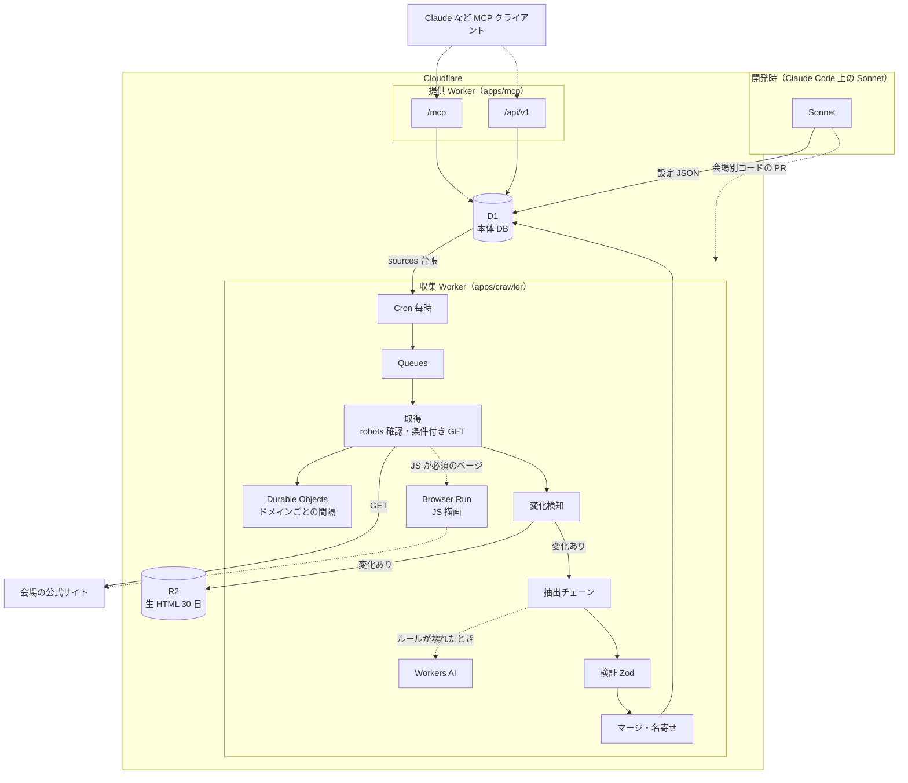
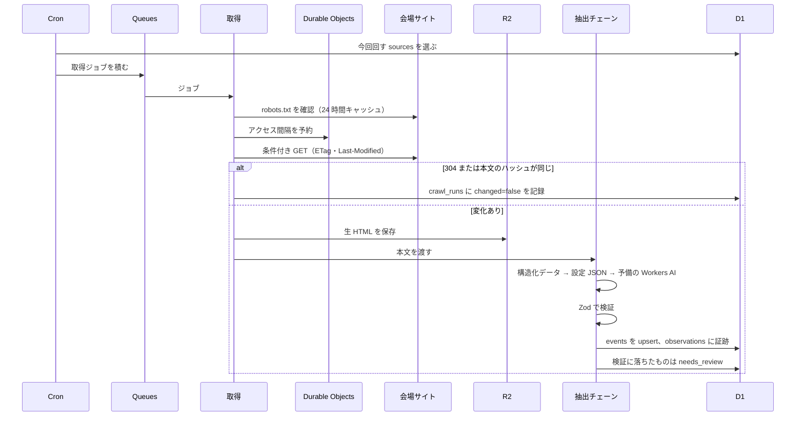
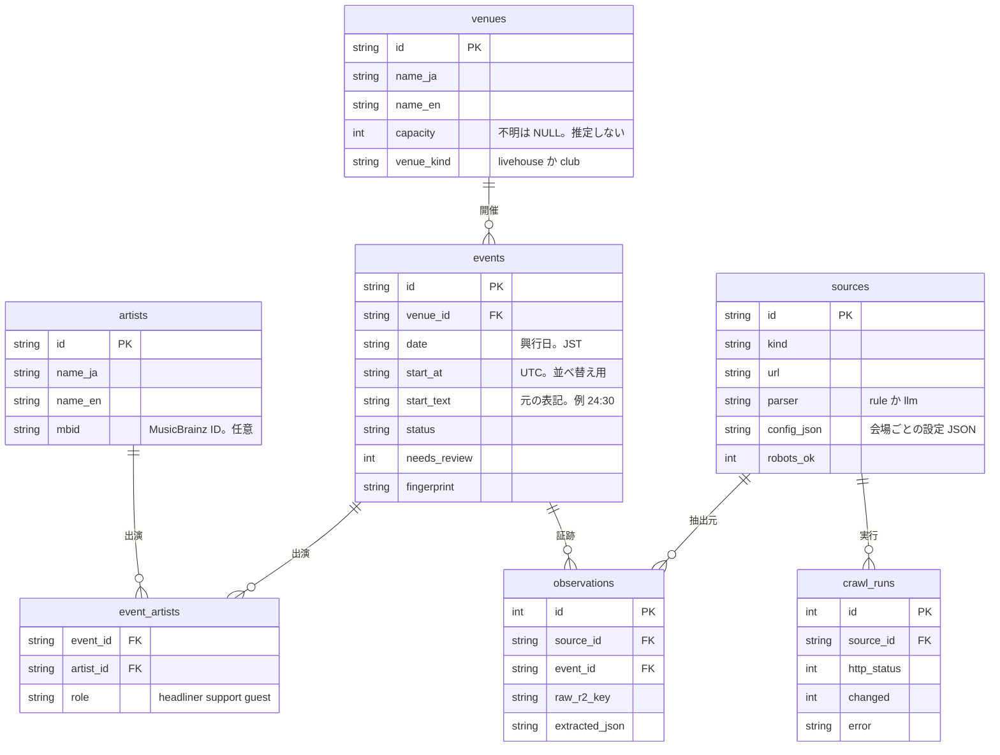
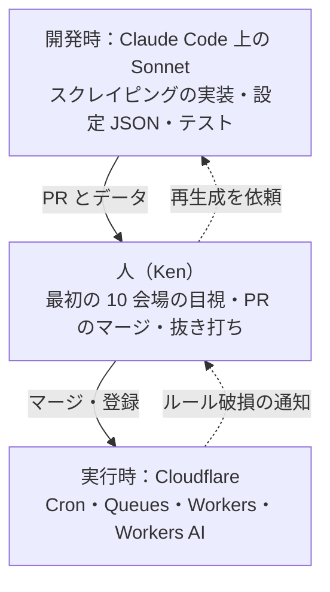

# アーキテクチャ

## 概要

東京の中小ライブ会場の公式スケジュールを毎日クロールして D1 に貯め、MCP で日英検索できるようにする。実行は Cloudflare のみで、実行時の LLM は Workers AI だけ。Sonnet は開発時にコードと設定 JSON を書く役で、実行時には呼ばない。

要件の合意事項は [requirements.md](requirements.md)、元の設計は [design-v0.1.md](design-v0.1.md)。食い違う箇所は要件メモが優先する。

## 1. 全体構成

収集 Worker と提供 Worker は D1 だけでつなぐ。収集側が止まっても、MCP は最後に取れたデータで答え続けられる。

| 部品 | 役割 |
| --- | --- |
| Cron / Queues | 毎時に台帳から対象を選び、取得ジョブを配って失敗時に再試行する |
| Durable Objects | 同一ドメインの同時接続 1・間隔 5 秒以上を 1 か所で守る |
| Browser Run | JS 描画が必要なページだけ HTML を取る。普通のページでは使わない |
| R2 | 変化があった生 HTML を解析用に 30 日だけ置く |
| Workers AI | ルールが壊れたときの予備の抽出、英語表記の生成 |
| D1 | 公演・会場・出演者の本体と、台帳、証跡、実行ログ |

## 2. 収集の流れ

大半のアクセスは「変化なし」で終わるので、抽出（LLM）まで進むのは変化があったページだけ。

抽出の分岐（構造化データ → 設定 JSON → 会場別コード → 予備の LLM）の詳細は、[requirements.md の設計判断 3](requirements.md) の図を正とする。

## 3. データモデル

「公演（events）」と「その情報をどこで見たか（observations）」を分ける。同じ公演を複数のページで見つけても 1 件にまとまる。

## 4. 役割分担

ルールが壊れたときは、予備の Workers AI 抽出に自動で戻り、再生成は人が Sonnet を起動して行う。
