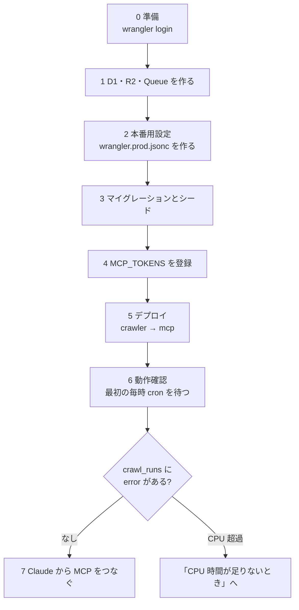

# デプロイ手順書（Cloudflare Free プラン）

## 概要

crawler と MCP の 2 つの Worker を、1 つの D1 を共有する形で Cloudflare に載せる。Free プランの範囲で動かす（100 会場・毎日 1 回でも、上限の 10 分の 1 以下の見込み）。**課金が始まる設定（Workers Paid・Workers AI の前払いクレジット）は有効にしない。**



**デプロイ前に Ken が決めること**: 連絡先 URL（`CRAWLER_CONTACT_URL`）。会場の運営者が開けて、掲載停止を申し出られるページにする。**リポジトリが private のあいだは、GitHub の Issues ページは外から開けないので連絡先にならない。** 個人情報（本名・メールアドレス）は入れない。

## 前提

- Node 22 以上、`npm ci` 済み。Cloudflare アカウント（Free）と `npx wrangler login`（ブラウザで承認。Ken が行う）
- 以下は特記がなければリポジトリ直下で実行する。D1 の id は秘密ではないが、リポジトリには置かない方針なので、本番用の設定ファイルを別に作る（手順 2）
- R2 の有効化のときにクレジットカードの登録を求められることがある。求められたら、Ken が判断する（Free 枠の範囲なら請求はない）

## 1. リソースを作る

```sh
npx wrangler d1 create live-info --location apac
npx wrangler r2 bucket create live-info-raw-html
npx wrangler queues create live-info-crawl --message-retention-period-secs 86400
```

- D1 の出力にある `database_id`（UUID）だけを控える。出力の設定例の `binding`（`live_info` など）はコピーしない。コード側は `DB` で参照している
- Queue の保持期間は Free では 60〜86400 秒。既定の 24 時間でよいので、上の指定は省いてもよい
- 生 HTML を 30 日で消すルール（要件）を設定する。反映は `list` で確かめる

```sh
npx wrangler r2 bucket lifecycle add live-info-raw-html raw-html-30d raw/ --expire-days 30
npx wrangler r2 bucket lifecycle list live-info-raw-html
```

## 2. 本番用の設定ファイルを作る

リポジトリの `wrangler.jsonc` は `database_id` がプレースホルダー。コピーして書き換え、コピーは gitignore 済み（`wrangler.prod.jsonc`）にする。`main` や `migrations_dir` は設定ファイルからの相対パスなので、同じディレクトリに置けばそのまま動く。

```sh
cp apps/crawler/wrangler.jsonc apps/crawler/wrangler.prod.jsonc
cp apps/mcp/wrangler.jsonc apps/mcp/wrangler.prod.jsonc
```

それぞれの `wrangler.prod.jsonc` で次の 2 点を編集する。

1. `d1_databases[0].database_id` を、手順 1 の UUID に置き換える（2 ファイルとも同じ値）
2. `apps/crawler/wrangler.prod.jsonc` に `vars` を足す（トップレベルに 1 行）

```jsonc
"vars": { "CRAWLER_CONTACT_URL": "<決めた連絡先 URL>" }
```

`CRAWL_FORCE` は本番では設定しない（20 時間の実行間隔を無視する、ローカル専用の設定）。

デプロイの前に、設定が通るかを確かめる（アップロードはしない）。

```sh
npx wrangler deploy --dry-run --outdir /tmp/dry-crawler -c apps/crawler/wrangler.prod.jsonc
npx wrangler deploy --dry-run --outdir /tmp/dry-mcp -c apps/mcp/wrangler.prod.jsonc
```

## 3. マイグレーションとシード

`--remote` を必ず付ける（付けないとローカルの D1 に流れる）。`seeds/dev-local-sources.sql` は**流さない**（取得先がローカル URL になる）。

```sh
cd apps/crawler
npx wrangler d1 migrations apply live-info --remote -c wrangler.prod.jsonc
for f in venues sources source-configs; do
  npx wrangler d1 execute live-info --remote -c wrangler.prod.jsonc --file ../../seeds/$f.sql
done
cd ../..
```

確かめる（5 会場・5 取得元・設定ありが 5 件）。

```sh
npx wrangler d1 execute live-info --remote -c apps/crawler/wrangler.prod.jsonc \
  --command "SELECT (SELECT COUNT(*) FROM venues) AS venues, (SELECT COUNT(*) FROM sources) AS sources, (SELECT COUNT(*) FROM sources WHERE config_json IS NOT NULL) AS configured"
```

## 4. MCP のトークンを登録する

値を画面に出さない。生成した値は、そのまま `wrangler secret put` の入力にし、同じ値を 1Password の `safe_vault` に保存する（保存は Ken が行う。Claude は `op` の書き込みをしない）。

```sh
openssl rand -hex 32 | pbcopy
npx wrangler secret put MCP_TOKENS -c apps/mcp/wrangler.prod.jsonc
```

プロンプトでクリップボードを貼り付ける。複数のトークン（人ごとに別）を使うときはカンマ区切り。`pbcopy` は値を端末に出さない。未設定のあいだ、MCP は 503 を返して開かない。

## 5. デプロイ

```sh
npx wrangler deploy -c apps/crawler/wrangler.prod.jsonc
npx wrangler deploy -c apps/mcp/wrangler.prod.jsonc
```

- 初回は `workers.dev` のサブドメインの登録を聞かれる。URL（`live-info-mcp.<サブドメイン>.workers.dev`）に残るので、決めてよい名前にする
- **crawler をデプロイした時点で毎時 0 分の cron が有効になり、次の 0 分に 5 会場の取得が始まる。** 連絡先 URL を入れてからデプロイすること
- 連絡先 URL がまだ決まっていないときは、`apps/crawler/wrangler.prod.jsonc` の `triggers` を `{ "crons": [] }` にしてデプロイする（Worker と Queue だけ用意し、取得は始めない）。決まったら `vars` を足し、`crons` を `["0 * * * *"]` に戻して再デプロイする（2026-11-25 の初回デプロイはこの形）
- 止めたいときは「止める・戻す」を参照

## 6. 動作確認

次の 0 分のあと、5 会場ぶん（5 秒間隔なので 2 分ほど）待ってから見る。

```sh
npx wrangler d1 execute live-info --remote -c apps/crawler/wrangler.prod.jsonc \
  --command "SELECT source_id, http_status, changed, error FROM crawl_runs ORDER BY started_at DESC LIMIT 10"
npx wrangler d1 execute live-info --remote -c apps/crawler/wrangler.prod.jsonc \
  --command "SELECT venue_id, COUNT(*) AS events, SUM(needs_review) AS review FROM events GROUP BY venue_id"
```

期待値は、5 件とも `http_status = 200`・`error` が空、公演数がローカルの実サイト実行（SHELTER 13・LOFT 10・duo 11・WOMB 10・UNIT 8 前後、日付により増減）に近いこと。リアルタイムで見るなら `npx wrangler tail live-info-crawler`。

MCP の疎通（トークンを画面に出さない）。

```sh
URL=https://live-info-mcp.<サブドメイン>.workers.dev/mcp
curl -s -o /dev/null -w "%{http_code}\n" -X POST "$URL"   # トークンなし → 401 になれば認証が効いている
```

## 7. Claude から使う

トークンはシェルの履歴に残さないよう、環境変数経由で渡す（`MCP_TOKEN` は 1Password から読んで `export` する）。

```sh
claude mcp add --transport http live-info "$URL" --header "Authorization: Bearer $MCP_TOKEN"
```

つないだら「今週の下北沢のライブを教えて」のように聞いて、`search_events` が返ることを確かめる。

## CPU 時間が足りないとき

Free の Workers は 1 回の呼び出しの CPU 時間が 10 ms。100〜150 KB の HTML の解析で超えるかどうかは、デプロイして初めて分かる（ローカルでは測れない）。

- 兆候: `crawl_runs.error` に空でない値が出る、`wrangler tail` に `Exceeded CPU` 系のエラーが出る、Queue が再試行を繰り返す
- 対応の選択肢: ①解析を軽くする（抽出前に対象の範囲だけ切り出す）、②会場ごとに呼び出しを分ける、③ Workers Paid（月 5 ドル〜）にする。③ は課金の設定なので、Ken が判断する

## 止める・戻す

- **取得を止める**: `apps/crawler/wrangler.prod.jsonc` の `triggers` を `{ "crons": [] }` にして再デプロイ。D1 のデータはそのまま残る
- **会場 1 つだけ止める**: `UPDATE sources SET robots_ok = 0 WHERE id = '<source_id>'`（期限の来た source の選定から外れる）
- **Worker を消す**: `npx wrangler delete -c apps/crawler/wrangler.prod.jsonc`（D1・R2・Queue は別に残る）

## 運用で見るもの

- Cloudflare のダッシュボードの Usage（D1・Queues・Workers AI の日次）。Free の上限を超えた日は、その操作がエラーになるだけで課金はされない（リセットは 00:00 UTC）
- 掲載停止の申し出が来たら、該当会場を止める（上の「会場 1 つだけ止める」）。連絡先 URL の窓口は Ken が見る
