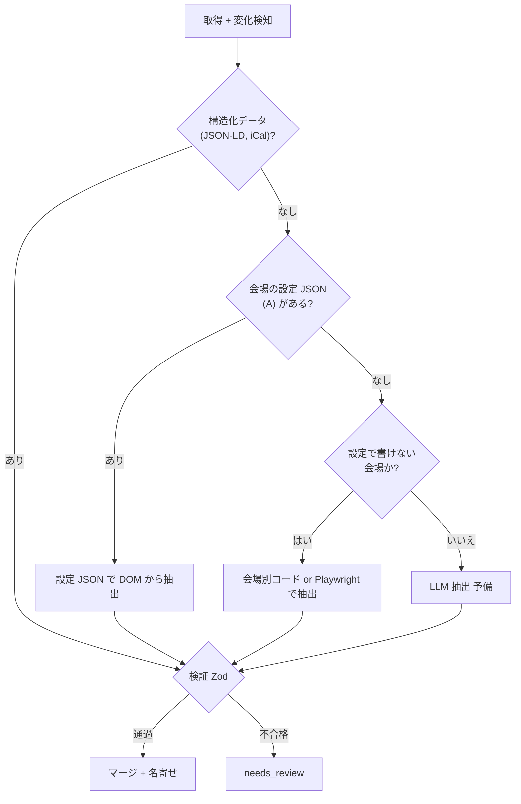

# ライブ情報 MCP 要件メモ（設計書 v0.1 への合意事項）

2026-11-20 · `grill-me` で詰めた結果。元の設計書は [design-v0.1.md](design-v0.1.md)（v0.1）。ここに書いたものは v0.1 より優先する。

## 概要

東京の中小ライブ会場（収容 50〜1000 人）の公演情報を毎日クロールして D1 にまとめ、MCP で日英検索できるようにする。基盤は Cloudflare のみ。

役割分担: 開発（スクレイピングの実装、設定 JSON、会場別コード、テスト）は Claude Code 上の Sonnet が行う。実行（毎日のクロール、抽出、予備の LLM 抽出）は Cloudflare のバッチ処理（Cron・Queues・Workers）と Workers AI だけで動かし、実行時に Sonnet は呼ばない。

MVP の目的は収益ではなく、**自分と知人が使い続けられること**。収益化・Web 画面・サービス名は Phase 2 以降に送る。

## スコープ

| やる | やらない |
| --- | --- |
| 東京都内、収容 50〜1000 人のライブハウスとクラブ | 東京以外、1000 人超の会場 |
| 台帳（sources）に登録した会場の公式スケジュール | チケットサイトのクロール、販売・転売情報 |
| 事実情報と出典 URL の提供 | 公式ページの本文・画像の再配信 |
| Bearer トークンによる知人限定公開 | 認証なしの公開、OAuth（Phase 3） |
| 日英表記（会場・出演者） | ジャンルの保持（MVP） |

## 受け入れ条件

- [ ] 台帳に登録した会場の、直近 7 日の公演の 9 割以上が取れている
  - 分母は、各会場の公式ページに載っている公演数。5 会場ずつ、人がサンプリングして測る
  - 台帳外の会場は対象外。最初に 100 会場を登録し、動いてから増やす
- [ ] 自分が週 3 回以上、Claude から MCP を引いている
- [ ] 収容人数の不明な会場は、公式サイトか人の確認で埋める（推定しない）
- [ ] T9: 同一公演の二重登録が無く、別公演が 1 件に潰れない
  - 実データから取ったパターン（開演時刻なし、1部と2部、同日に複数イベント、出演者の表記ゆれ）をフィクスチャにしたテストを含める

## 設計判断

### 1. 同一公演の判定（v0.1 の `venue_id + date + start_time` を補強）

1. `venue_id + date + start_time` が一致し、出演者が 1 人以上重なる → 同一
2. `start_time` が片方で空 → `venue_id + date` が一致し、ヘッドライナーが一致すれば同一
3. それ以外 → 別公演として登録し、`needs_review` の印を付ける

迷ったら「まとめず別々に持つ」側に倒す。二重登録は利用者が見て気づけるが、公演が消えると気づけない。

### 2. 時刻の持ち方（v0.1 の `start_time = 24:30` を変更）

| 列 | 内容 |
| --- | --- |
| `date` | 興行日。公式ページに書かれた日付のまま（24:30 開演でも同じ日付） |
| `start_at` | 開演時刻を UTC の ISO 日時で持つ。並べ替えと「いま開催中」の判定に使う |
| `start_text` | 元の表記（`"24:30"`）。MCP の返却ではこちらを表示に使う |

- 表示は JST で、興行日の 0:00 から翌日 4:59 までを `00:00`〜`28:59` と表記する（例: 翌日 0:30 → `24:30`）
- 入力は `0:00`〜`28:59` を許し、UTC に変換する。`29:00` 以降は抽出の検証で弾き、`needs_review` にする

### 3. 抽出方式（v0.1 の T8 を変更）

- **A（設定 JSON）**: 会場ごとに「公演の要素・日付・出演者・時刻・チケット URL がどこにあるか」を CSS セレクタと正規表現で書いた JSON。開発時に、Claude Code 上の Sonnet がページを 1 度読んで書く（人が起動する。実行時に Sonnet は呼ばない）。実行は共通のクローラー 1 つで、LLM は使わない。D1 の `sources` に置くので、直してもデプロイは要らない
- **B（会場別コード / Playwright）**: A で書けない会場だけ。Sonnet が書き、保存済み HTML をフィクスチャにしたテストを付けて PR にする。マージは人が行う。Workers では `eval` が使えないため、実行時に読み込む形にはできず、デプロイが要る
- JS で描画されるだけのページは、Browser Run で描画した HTML を A で読む（B ではない）。ボタン操作が要るページだけ Playwright を使う（確認済み 2026-11-21: Browser Run は `@cloudflare/playwright`（v1.3.0 以上）で Playwright に対応し、Worker からは `browser` バインディングで `launch(env.MYBROWSER)` する。描画済み HTML だけなら、バインディングの `quickAction("content", { url })` が使える。`/content` の返り値の形式は実際に呼んで確かめる）
- 実行時の LLM は Cloudflare（Workers AI）だけにする。Sonnet は開発時のプログラミング（設定 JSON・会場別コード・実装）専用で、実行時には呼ばない
- 実行時の LLM 抽出（Workers AI）は、ルールが壊れたときの予備に下げる。検証に落ちたものを大きいモデルへ上げる場合も、Workers AI の中でモデルを切り替える
- HTML パーサーは `linkedom` や `node-html-parser` と HTMLRewriter を T4〜T6 で比べて選ぶ（Workers での動作は未検証）

### 4. ルールの採用基準（v0.1 の「直近 3 回の LLM 抽出と一致」を変更）

- 最初の 10 会場は、あなたが抽出結果を全件目視する
- 11 会場目以降は、次の 3 つがすべて通れば自動で採用する
  1. ルールの結果と、LLM 抽出が一致する
  2. 抽出件数が、ページ上の公演らしき要素の数と一致する
  3. 日付・会場・出演者の検証（過去日、2 年以上先、出演者が空）を通る
- 外れた会場は `needs_review` にして、人の確認待ちにする
- 採用後も、毎週ランダムに 5 会場を抜き打ちで目視する
- 一致の独立性のため、LLM 抽出の確認には、ルール生成に使った Sonnet とは別のモデル（Workers AI）を使う

### 5. Workers AI の使用量の上限（v0.1 の Sonnet 費用上限を置き換え）

実行時に Sonnet を呼ばないので、Sonnet の回数上限は設けない。代わりに Workers AI の使用量を管理する。

- D1 の日別カウンターで Workers AI の呼び出し回数と使用量（Neurons）を数え、消費が一定を超えたら通知する（T12 の監視に入れる）
- 上限を超えた分は `needs_review` に積んで翌日に回す
- Phase 0 の 5 会場で実際の使用量を測り、上限を決める

### 6. その他

| 論点 | 決定 | 理由 |
| --- | --- | --- |
| ジャンル | MVP は持たない | 推定は誤りが出て「事実のみ返す」価値を下げる。`keyword` が題名と出演者名を検索すれば足りる。Phase 1 後半に MusicBrainz のタグを検討 |
| 公開範囲 | Bearer トークンで知人だけ。認証なしの公開はしない | URL が広まるとデータを誰でも引ける。止めにくい |
| 法務 | 弁護士確認は行わない（リスク受容）。robots.txt、ドメインごとの間隔 5 秒以上、エラー時のバックオフ、User-Agent の連絡先、事実のみ返す、は残す | 判断はユーザー。サービスを止めない最低限は維持する |
| クラブ | 対象に入れる。Phase 0 の 5 会場は、ライブハウス 3 とクラブ 2 に分け、クラブで取れる割合を先に測る | 取れなければクラブは Phase 2 に回す。深夜表記（28:59）はクラブで効く |
| 名寄せ | DJ 名・クルー名は表記ゆれが多く、T10 の難易度が上がる | MusicBrainz に載りにくい |

## v0.1 から直す点

- L179「溶り」→「拾い」
- `events.start_time` → `date` / `start_at` / `start_text` の 3 列（T2）
- T8 の担当を、ローカル LLM から Sonnet に変更。成果物は設定 JSON（A）
- 公開範囲を「認証なし」から「Bearer トークンで限定」に変更
- 未決事項から「公開前の弁護士確認」を削除
- 実行時の LLM は Workers AI のみとし、Sonnet は開発時のプログラミング専用にする。実行時の LLM 抽出は予備に格下げし、Sonnet の 1 日 50 回の上限は置かず、Workers AI の使用量を日別に数えて通知する
- `createMcpHandler`（`agents/mcp/server`）と MCP SDK v2 は、公式ドキュメントで確認済み（2026-11-21）。パッケージは `@modelcontextprotocol/server`（`@modelcontextprotocol/sdk` ではない）で、`agents` の任意の peer dependency になる。バージョンは、入れた `agents` が要求するものに合わせる（ドキュメントの例は 2.3.1）。ハンドラーには、サーバーのインスタンスでなく生成関数を渡す。既定のパスは `/mcp`
- Browser Run の料金と上限（確認済み 2026-11-21）: Workers Paid で月 10 時間まで含み、超過は 1 時間 0.09 ドル。Quick Actions は毎秒 30 リクエストまで。MVP の見積もり（月 3.3 時間）は含まれる範囲に収まる
- wrangler の設定は、MCP のドキュメントのページに無かった（Playwright 側のページには `nodejs_compat` と新しい `compatibility_date` が必要とある）。T1 で実際に `wrangler dev` を動かして決める

## 収益化の方向（決定は方向のみ。実装は条件が揃ってから）

- **形**: 無料 MCP と有料 API。個人の利用は無料で、旅行・インバウンド事業者やメディアに API キー制で提供する。アフィリエイト（公式チケット URL の置き換え）とデータ販売は採らない
- **目標**: 副業として月数万円。目安は、月 3,000 円の契約 10 件、または月 1 万円の契約 3 件（価格と件数は仮置きで、需要を聞いてから決める）
- **開始条件**: 受け入れ条件（網羅率 9 割、週 3 回の利用）が出ており、自分以外から「使いたい」という声が実際に来たこと
- **MVP でやること**: `source_url` を全公演に付ける、MCP と共通のハンドラーの REST（`/api/v1`）を用意する、の 2 つだけ。課金・API キー・OAuth は Phase 3
- **課金を始める時点でやること**: 利用規約と提供範囲（事実情報と出典 URL のみ）を見直す。有料化で、検索用データベースの複製という整理（著作権法 47 条の 5 の考え方）の前提が変わるため

## 未決（Phase 2 に送る）

- [ ] Web 画面を作るか（海外ファン向け）
- [ ] サービス名とドメイン

## リスク

- 課金を始めると、無料の個人利用より、クロールと再提供への風当たりが強くなる。弁護士確認をしない判断は、課金の開始時に見直す（上の収益化の節）

- 弁護士確認なしのため、クロールに対する苦情や停止要請が来たときは、台帳の `robots_ok = false` で即時に止める運用を取る
- クラブは SNS 告知が中心で、公式サイトに載らない会場がある。取れる割合が低ければ範囲から外す
- 設定 JSON が壊れたとき（件数の急減、検証エラーの増加）は、予備の LLM 抽出（Workers AI）に自動で戻し、ルールの再生成を保留キューに入れる。再生成そのものは自動では行わず、人が Claude Code 上の Sonnet を起動して行う
